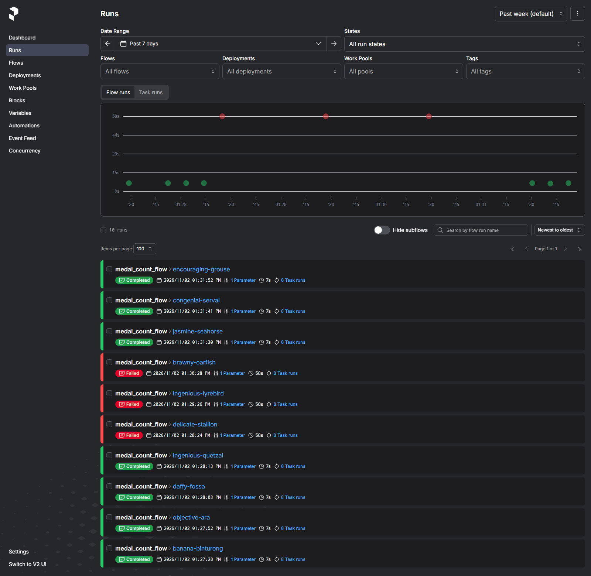
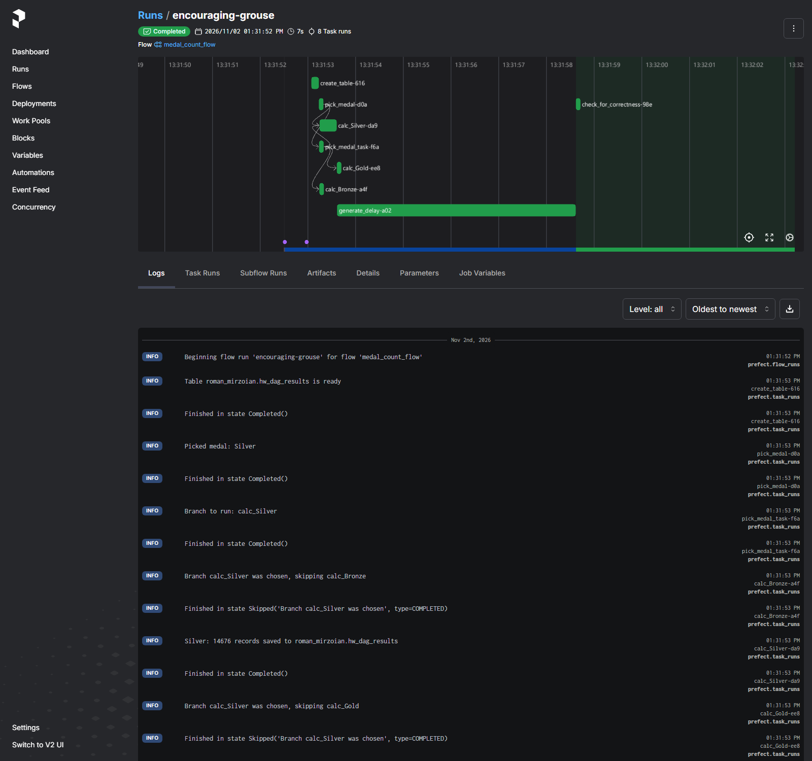
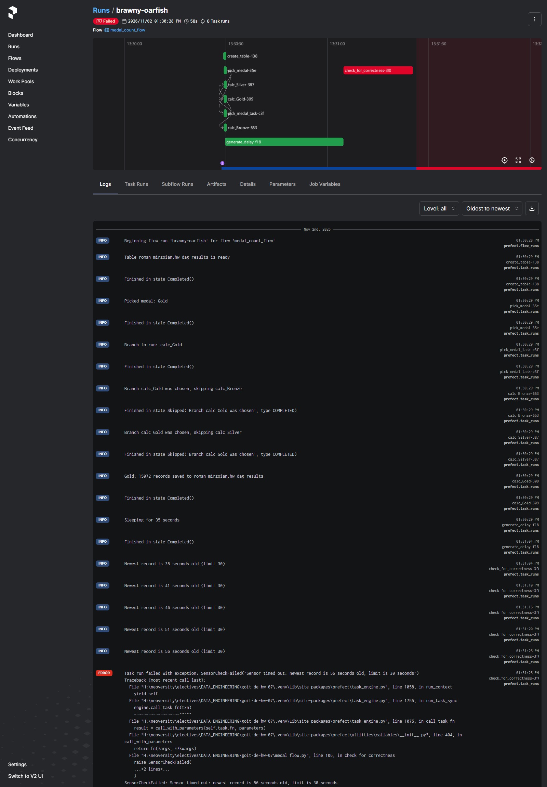
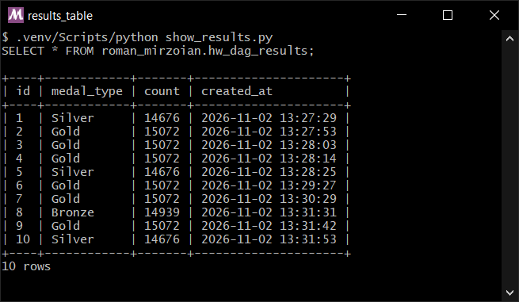

# goit-de-hw-07

Оркестрація обробки даних: розгалуження, затримка та сенсор. Замість Apache Airflow використав **Prefect 3**, в мене Windows

## Кроки flow

| # | Задача | Що робить | Аналог в Airflow |
|---|---|---|---|
| 1 | `create_table` | `CREATE TABLE IF NOT EXISTS roman_mirzoian.hw_dag_results` з полями `id` (автоінкремент, первинний ключ), `medal_type`, `count`, `created_at` | `MySqlOperator` |
| 2 | `pick_medal` | Випадково обирає `Bronze`, `Silver` або `Gold` | `PythonOperator` |
| 3 | `pick_medal_task` | Визначає гілку `calc_<medal>`, яку треба запустити | `BranchPythonOperator` |
| 4 | `calc_Bronze` / `calc_Silver` / `calc_Gold` | Обрана гілка рахує записи з відповідною медаллю в `olympic_dataset.athlete_event_results` і записує `medal_type`, `count`, `NOW()` у таблицю результатів. Дві інші завершуються в стані **Skipped** | `MySqlOperator` + skipped |
| 5 | `generate_delay` | `time.sleep(delay_seconds)`; запускається лише якщо обрана задача з кроку 4 завершилась успішно | `PythonOperator` |
| 6 | `check_for_correctness` | Сенсор: кожні 5 с протягом 20 с перевіряє `TIMESTAMPDIFF(SECOND, MAX(created_at), NOW()) <= 30`. Якщо запис так і не став «свіжим» — задача і весь flow падають (**Failed**) | `SqlSensor` |

Затримка задається параметром `delay_seconds`: при 5 с сенсор проходить одразу, при 35 с найновіший запис уже старший за 30 с, тож сенсор падає.

### Список запусків

7 запусків **Completed** і 3 **Failed** (затримка 35 с). На графіку зверху — тривалість: успішні ~7 с, ті, що впали, ~58 с (35 с затримки + 20 с роботи сенсора).

### Успішний запуск

Обрано `Silver`: виконалась задача `calc_Silver` (14676 записів), `calc_Bronze` і `calc_Gold` завершились у стані **Skipped**. Після затримки 5 с сенсор бачить, що найновішому запису 5 с, і проходить.

### Запуск із падінням сенсора

Обрано `Gold`, після `calc_Gold` затримка 35 с. Сенсор кожні 5 с перевіряє вік найновішого запису: 35, 41, 46, 51, 56 с — усі більше 30 с, тож через 20 с задача `check_for_correctness` падає з `SensorCheckFailed`, а разом із нею і весь flow.

### Таблиця результатів

`roman_mirzoian.hw_dag_results` після всіх запусків: тип медалі, кількість записів і час створення. Запис з'являється в кожному запуску, зокрема й у тих, що впали: сенсор падає не через відсутність запису, а через те, що на момент перевірки він старший за 30 с.

